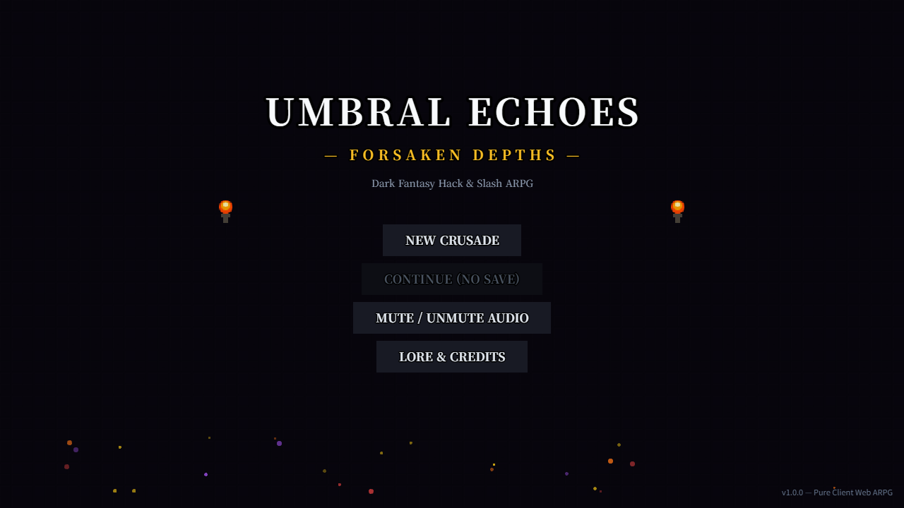
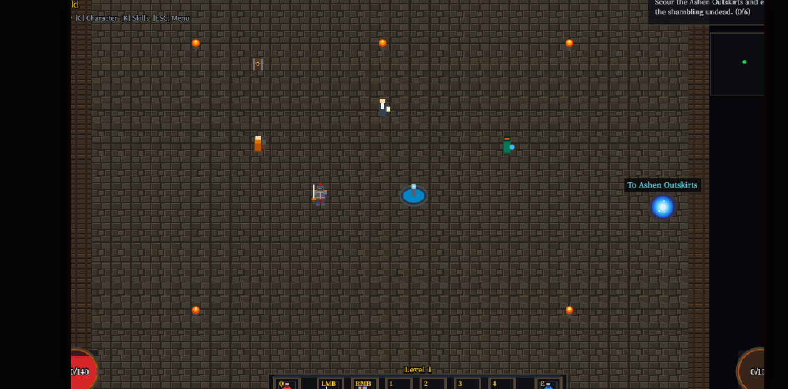

# ⚔️ UMBRAL ECHOES: FORSAKEN DEPTHS
> **A 2D Dark Gothic Fantasy Hack & Slash ARPG in the Browser**  
> *Built with TypeScript, Vite, and Phaser 3 — 100% Client-Side with Zero Server/Login Required.*

[](https://github.com/jeiel85/umbral-echoes-arpg/actions/workflows/deploy.yml)
[](https://jeiel85.github.io/umbral-echoes-arpg/)

---

## 🎮 Live Demo
Experience the complete game directly in your desktop browser:  
👉 **[https://jeiel85.github.io/umbral-echoes-arpg/](https://jeiel85.github.io/umbral-echoes-arpg/)**




---

## 📖 Game Overview
**Umbral Echoes: Forsaken Depths** is a finished, fully playable gothic dark fantasy hack-and-slash action RPG. Step into the boots of a battle-hardened crusader and descend through ruined ashen outskirts, haunted graveyards, toxic mires, and sunken catacombs to breach the **Abyssal Citadel** and banish **Malagath, the Void Sovereign**.

### Core Gameplay Loop
```
Oakhaven Refuge (Town Hub)
    ↓ Restock potions, speak with Elder Corvus, trade with Blacksmith Valerius
Field & Dungeon Exploration
    ↓ Slay 10+ monster types & champion elites
Real-time Hack & Slash Combat
    ↓ Hit-stop, screenshake, floating combat text & crit numbers
Loot Drops & Farming
    ↓ Common, Magic, Rare, and game-changing Legendary equipment
Leveling & Skill Tree Allocation
    ↓ Unlock 8 active/passive disciplines per class
Boss Encounters
    ↓ Multi-phase telegraphed showdowns (Malakor, Vane, Malagath)
Victory & Epilogue
    ↓ Epilogue screen & Crusade summary stats
```

---

## 🕹️ Controls

| Key / Input | Action |
| :--- | :--- |
| **W, A, S, D** | Move Crusader |
| **Left Mouse Button (LMB)** | Primary Attack / Cleave / Arcane Bolt |
| **Right Mouse Button (RMB)** | Core Heavy Skill (Seismic Slam / Glacial Nova) |
| **1, 2, 3, 4** | Active Hotbar Skills |
| **Space** | Evade / Combat Roll / Phase Shift (with Invulnerability Frames) |
| **Q** | Drink Crimson Flask (Health Potion) |
| **E** | Drink Azure Phial (Resource / Mana Potion) |
| **I** | Toggle Inventory & Equipment Screen |
| **C** | Toggle Character Attribute Sheet |
| **K** | Toggle Skill Discipline Tree |
| **Tab** | Expand / Minimize Tactical Radar Minimap |
| **ESC** | Pause Menu / Resume / Manual Save / Settings |

*Note: Cursor hover over interface panels automatically suppresses attack inputs to prevent accidental swings.*

---

## 🛡️ Playable Classes

### 1. Vanguard (The Iron Sentinel)
* **Playstyle**: Melee juggernaut clad in heavy steel plate, wielding a two-handed jagged greatsword. Builds **Fury** in the crucible of melee combat.
* **Skills**:
  1. `Cleave` (LMB) — Sweeping 140% arc strike that generates Fury.
  2. `Seismic Slam` (RMB) — Shatters the ground, stunning enemies for 1.2s.
  3. `Iron Rush` (Key 1) — Violent forward charge that barrels through and knocks back foes.
  4. `Whirlwind` (Key 2) — 2-second continuous spinning tempest of steel.
  5. `War Cry` (Key 3) — Battle roar granting +35% Armor and +25% Attack Damage.
  6. `Leap of Retribution` (Key 4) — High aerial leap crushing enemies at the cursor for 340% damage.
  7. `Iron Will` (Passive) — +25% Maximum Life and +20% Armor.
  8. `Bloodthirst` (Passive) — Critical strikes heal 5% max HP and grant +15% Attack Speed.

### 2. Arcanist (The Umbral Weaver)
* **Playstyle**: Ranged spellcaster in hooded mystic robes wielding an ancient bone staff. Rapidly channels and regenerates **Mana**.
* **Skills**:
  1. `Arcane Bolt` (LMB) — Piercing magic spear dealing 130% spell damage.
  2. `Glacial Nova` (RMB) — Expanding frost ring that slows and freezes nearby foes.
  3. `Void Shift / Blink` (Key 1) — Instant 240px ethereal teleport with invulnerability frames.
  4. `Cataclysm Meteor` (Key 2) — Blazing celestial meteor crashing down with lingering fire.
  5. `Chain Lightning` (Key 3) — Violent electric surges jumping between multiple enemies.
  6. `Umbral Ward` (Key 4) — Shadow energy barrier absorbing damage up to 45% of max HP.
  7. `Arcane Overflow` (Passive) — +50 Maximum Mana and +20% Spell Damage.
  8. `Elemental Ruin` (Passive) — +10% Critical Chance with bonus elemental explosions.

---

## 💎 Loot & Legendary Equipment System

* **8 Equipment Slots**: Head, Chest, Gloves, Boots, Weapon, Ring 1, Ring 2, Amulet.
* **4 Rarity Tiers**: Common (White), Magic (Blue), Rare (Yellow), Legendary (Orange with radiant vertical ground beam).
* **Game-Changing Legendary Items**:
  1. **Crown of the Primordial King** — Seismic Slam emits 3 fracturing shockwaves in a cone.
  2. **Armor of the Ironclad Juggernaut** — Taking damage has a 25% chance to trigger an explosive counter-burst.
  3. **Grave-Reaper's Edge** — Kills grant +12% movement and attack speed for 5s (stacks up to 5x).
  4. **Staff of Infinite Horizons** — Arcane Bolt pierces all targets and splits into twin homing shards.
  5. **Cinderfall Greaves** — Leaves a trail of burning embers that scorches pursuing foes.
  6. **Ring of the Abyssal Void** — Glacial Nova pulls nearby enemies inward before freezing them solid.
  7. **Amulet of the Blood Pact** — Critical hits instantly restore 6% of maximum Life.
  8. **Hands of the Thunderlord** — Chain Lightning jumps to 3 additional targets with 50% increased damage.

---

## 👹 Monster & Boss Design

* **10 Distinct Enemy Types**:
  * *Hollow Wanderer* — Swarming melee ghoul with rusted sickles.
  * *Dire Bloodhound* — Fast quadruped demonic beast that lunges aggressively.
  * *Skeleton Archer* — Tactical archer that kites and shoots bone arrows from range.
  * *Blight Spitter* — Bloated abomination spitting noxious bile pools.
  * *Bone Breaker* — Armored hulking brute with wind-up charge attacks.
  * *Shadow Wraith* — Spectral phantom that teleports behind you for surprise strikes.
  * *Cultist Necromancer* — Dark chanter that hurls void orbs and summons skeletons.
  * *Gargoyle Sentinel* — Winged stone beast with high armor resistance.
  * *Volatile Corpse / Plague Bomber* — Infested suicide zombie that explodes in toxic fire on death.
  * *Void Chanter* — High-level mystic radiating dark energy runes and buffing nearby allies.
* **Elite Champion System**:
  * Random champions spawn with distinct glowing auras and affixes: `Fast`, `Vampiric`, `Flame Aura`, `Frost`, `Poison`, `Shielded`, `Berserk`.
* **Multi-Phase Bosses**:
  * **Grave Lord Malakor** (Cursed Graveyard) — Giant soul scythe sweeps, bone wall traps, and multi-directional soul volleys.
  * **Arch-Inquisitor Vane** (Sunken Catacombs) — Flaming executioner greatsword, erupting fire pillar telegraphs, and holy wrath.
  * **Malagath, the Void Sovereign** (Abyssal Citadel Final Boss) — 3 distinct phases: Void slices, gravitic vortex pulling player, and phase-3 bullet-hell ring barrages!

---

## 💾 Save System
The game automatically synchronizes progress to `localStorage`:
* Selected Class, Level, Experience, Gold, Health/Mana Potions.
* 24-slot Inventory and all equipped gear with exact rolled stats.
* Unlocked skills, skill points, and hotbar assignments.
* Campaign quest progress and completed objectives.
* Current explored zone.
* Provides **Continue**, **New Game**, and **Reset Local Save** options on the main menu.

---

## 🛠️ Project Structure
```
d2-prompt/
├── index.html                       # HTML5 canvas container and dark styling
├── package.json                     # Dependencies & scripts
├── tsconfig.json                    # TypeScript compiler configuration
├── vite.config.ts                   # Vite bundler configuration (relative base for Pages)
├── CREDITS.md                       # Licensing & attributions
├── .github/
│   └── workflows/
│       └── deploy.yml               # Automated GitHub Pages CI/CD workflow
├── scripts/
│   └── test-gameplay.mjs            # Autonomous end-to-end CDP verification suite
└── src/
    ├── main.ts                      # Game bootstrapper
    ├── config.ts                    # 1280x720 16:9 canvas & arcade physics config
    ├── audio/
    │   └── SoundEngine.ts           # Web Audio API procedural sound engine
    ├── graphics/
    │   └── TextureGenerator.ts      # Real-time procedural canvas pixel-art generator
    ├── entities/
    │   ├── Player.ts                # Player controller (Vanguard & Arcanist)
    │   ├── Enemy.ts                 # 10 monster types + Elite affix system
    │   ├── Boss.ts                  # Multi-phase boss mechanics & telegraphs
    │   ├── NPC.ts                   # Town merchants & quest givers
    │   ├── Projectile.ts            # Piercing bolts, arrows, and void orbs
    │   └── AreaEffect.ts            # Ground hazard pools and meteor craters
    ├── combat/
    │   ├── CombatSystem.ts          # Hit detection, skill execution, and loot drops
    │   ├── DamageNumber.ts          # Floating damage, crit, heal, and status text
    │   └── HitFeedback.ts           # Hit-stop, camera shake, white flash, and particles
    ├── skills/
    │   ├── SkillTypes.ts            # Skill interfaces & slot types
    │   ├── SkillDefinitions.ts      # 16 complete class skills
    │   └── SkillManager.ts          # Unlocks, cooldown timers, and slot assignments
    ├── items/
    │   ├── ItemTypes.ts             # Slots, rarities, stats, and legendary perks
    │   ├── ItemGenerator.ts         # Randomized stat rolls & legendary catalog
    │   ├── InventoryManager.ts      # 24-slot grid, 8 gear slots, and calculations
    │   └── DropItem.ts              # Ground loot markers with vertical rarity beams
    ├── world/
    │   ├── WorldData.ts             # 5 detailed gothic regions & encounter layouts
    │   └── AreaManager.ts           # Tile placement, boundaries, chests, and portals
    ├── quests/
    │   ├── QuestTypes.ts            # Quest models & rewards
    │   └── QuestManager.ts          # Main campaign & side quest state tracking
    ├── save/
    │   └── SaveManager.ts           # localStorage persistence & deserialization
    ├── ui/
    │   ├── HUD.ts                   # Health/Resource globes, hotbar, and boss bar
    │   ├── InventoryUI.ts           # Grid inventory, equip slots, and tooltips
    │   ├── CharacterUI.ts           # Full RPG attribute sheet
    │   ├── SkillTreeUI.ts           # Skill allocation & hotbar assignment modal
    │   ├── ShopUI.ts                # Merchant buying & selling interface
    │   ├── DialogueUI.ts            # NPC narrative & quest turn-in window
    │   ├── MinimapUI.ts             # Tactical radar minimap overlay
    │   └── PauseMenuUI.ts           # Pause, manual save, audio toggle, and exit
    └── scenes/
        ├── BootScene.ts             # Procedural texture generator kickoff
        ├── MainMenuScene.ts         # Main title, New Game, Continue, and Credits
        ├── CharacterSelectScene.ts  # Vanguard vs Arcanist character selection
        ├── GameScene.ts             # Master gameplay coordinator
        └── EndingScene.ts           # Final boss victory epilogue & run summary
```

---

## 🚀 Running Locally

### Prerequisites
* [Node.js](https://nodejs.org/) (version 18 or higher)
* [npm](https://www.npmjs.com/)

### Installation & Development
```bash
# 1. Clone the repository
git clone https://github.com/jeiel85/umbral-echoes-arpg.git
cd umbral-echoes-arpg

# 2. Install dependencies
npm install

# 3. Start local development server
npm run dev
```
Open your browser at `http://localhost:3000` to play!

### Production Build
```bash
# Compile TypeScript and bundle with Vite
npm run build

# Preview production build locally
npm run preview
```

### Automated End-to-End Verification Test
```bash
# Run headless Chrome automated verification suite
node scripts/test-gameplay.mjs
```

---

## 📜 License
* Code released under the [MIT License](LICENSE).
* See [CREDITS.md](CREDITS.md) for full licensing details and asset attributions.
